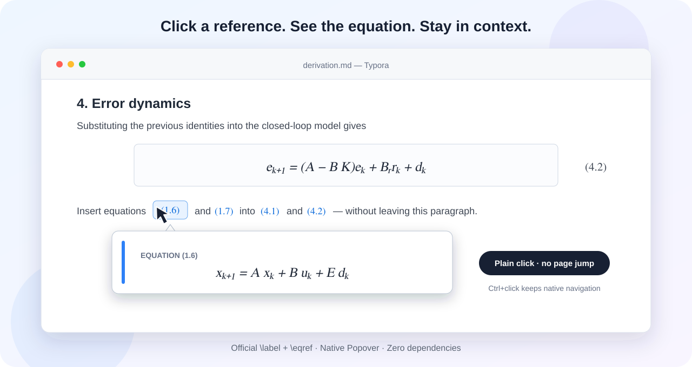

<h1 align="center">Typora Equation Preview</h1>
<p align="center"><strong>Follow the math. Keep your place.</strong><br>Equation popovers, clean display math, and reusable notes for Typora.</p>
<p align="center">
  <a href="README.zh-CN.md">简体中文</a> · <a href="#install">Install</a> · <a href="#four-tools-one-menu">Features</a> · <a href="https://github.com/guan695/typora-equation-preview/issues">Feedback</a>
</p>
<p align="center">
  <a href="https://github.com/guan695/typora-equation-preview/actions/workflows/test.yml"></a>
  <a href="LICENSE"></a>
  
  
  <a href="https://github.com/guan695/typora-equation-preview/stargazers"></a>
</p>


<sub>Feature illustration. The Plugin button sits beside the source-mode toggle on the bottom status bar; its menu opens upward. Appearance follows your Typora theme.</sub>

Reading a derivation should not mean scrolling back and forth to find an equation. Writing a short explanation should not mean rebuilding a callout every time.

This lightweight Windows enhancement adds **four tools to one Plugin menu**, using a single JavaScript file and Typora's native math rendering, blocks, and undo history.

## Four tools, one menu

| Tool | What you get | How to use it |
|---|---|---|
| **Equation-reference preview** | See the referenced formula without leaving the paragraph | Click a rendered `\ref` / `\eqref`; Ctrl+click keeps the native jump |
| **Display-math formatting** | Turn standalone `$$…$$`, `\[ … \]`, and `\( … \)` into multiline display blocks | Plugin → 全文独立公式 → 居中公式块 |
| **Reusable NOTE blocks** | A native blue NOTE callout with a horizontal rule above and below | Plugin → 插入补充说明; select content to wrap it, or start with a placeholder |
| **Batch heading demotion** | Lower selected H1–H5 headings by one level | Select a range, then Ctrl+Alt+↓ or use the menu |

Display-math formatting and NOTE insertion also work in source mode. Each edit can be undone as a batch. Ordinary inline formulas stay inline.

## Install

**Windows · validated with Typora 1.14.9 on Windows 11.**

1. [Download the ZIP](https://github.com/guan695/typora-equation-preview/archive/refs/heads/main.zip) and extract it, or clone this repository.
2. Save your documents and **fully exit Typora**.
3. Open PowerShell in the extracted repository folder and run:

   ```powershell
   powershell -NoProfile -ExecutionPolicy Bypass -File ".\install.ps1"
   ```

4. Accept the administrator prompt and reopen Typora. Look for **Plugin** beside the source-mode toggle on the bottom status bar. If the status bar is hidden, enable **View → Show Status Bar**.

For a custom installation location:

```powershell
powershell -NoProfile -ExecutionPolicy Bypass -File ".\install.ps1" -TyporaRoot "D:\Apps\Typora"
```

The installer backs up `resources\window.html` before adding the script. It disables the legacy `typora_plugin` injection if present and keeps its files. This is an unofficial enhancement, and a Typora update may require reinstalling it.

## Try it in a minute

### Preview an equation reference

Enable **Inline Math** under Typora's Markdown → Math preferences, then paste:

```tex
$$
E = mc^2
\label{eq:energy}
\tag{1.6}
$$

Substitute $\eqref{eq:energy}$ into the next equation.
```

Click the rendered reference to open the formula in place. Click outside or press Esc to close it. Ctrl+click still jumps to the formula. Use Typora's [official cross-reference syntax](https://support.typora.io/Math/); plain text such as `(1.6)` is not treated as a reference.

<details>
<summary>See the equation-preview illustration</summary>



</details>

### Format display math

Before:

```tex
$$A = U \Sigma V^T$$
```

After **Plugin → 全文独立公式 → 居中公式块**:

```tex
$$
A = U \Sigma V^T
$$
```

Standalone `\[ … \]` and `\( … \)` are supported too, including formulas in nested lists. Already formatted blocks are kept; inline formulas, code blocks, code spans, YAML front matter, and common HTML blocks are skipped. Quoted formulas are preserved.

### Add a short explanation

Enable **GitHub Style Alert / Callouts** in Typora's preferences. Put the cursor in a paragraph, or select the explanation you have already written, then choose **Plugin → 插入补充说明**:

```markdown
***

> [!NOTE]
> **补充说明**
>
> 在这里填写讲解内容。

***
```

With no selection, the placeholder is selected for immediate typing. With a selection, paragraphs, formulas, bold text, and lists are wrapped in the note. The native NOTE type is preserved after insertion and redo. Edit the title directly. Source mode supports one cursor or selection at a time.

## Update, undo the installation, or restore a previous plugin

To update, download the current files, exit Typora, and rerun the installer.

```powershell
# Remove this enhancement
powershell -NoProfile -ExecutionPolicy Bypass -File ".\install.ps1" -Action Uninstall

# Restore the legacy typora_plugin injection, if its files are present
powershell -NoProfile -ExecutionPolicy Bypass -File ".\install.ps1" -Action RestoreLegacy
```

## Feedback and development

Found a problem? [Open an issue](https://github.com/guan695/typora-equation-preview/issues/new/choose) with your Typora version, Windows version, and a small Markdown sample. Feature ideas and focused pull requests are welcome.

No build step or npm installation is needed. To run the checks with Node.js 22 or newer:

```powershell
node --check .\heading-demoter.js
node .\test.js
```

The self-test covers parsing, selection adapters, menu wiring, NOTE styling repair, and redo snapshots. It does not launch Typora. The historical script filename `heading-demoter.js` is retained for installation compatibility.

[Changelog](CHANGELOG.md) · [MIT license](LICENSE) · [中文说明](README.zh-CN.md)

**If this saves you a little scrolling or formatting, a [⭐ star](https://github.com/guan695/typora-equation-preview) helps other Typora users discover it.**
