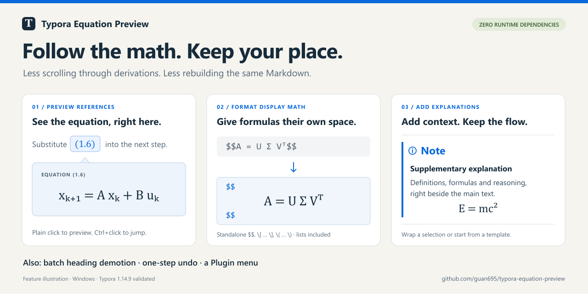

# Typora Equation Preview

**少翻几页公式，少整理几遍格式。**

为 Typora 补上公式引用就地预览、全文独立公式整理、通用补充说明模板与选区标题降级。一个 JavaScript 文件，零运行时依赖。

[English](README.md) · [下载安装](#下载安装) · [反馈问题](https://github.com/guan695/typora-equation-preview/issues)



> 上图是功能示意图。实际样式随 Typora 主题变化；Plugin 是窗口内的顶部按钮。

## 适合什么场景

- 读论文或推导，引用的公式在几页之外，想在当前位置看一眼。
- 从其他地方粘贴的 `$$公式$$` 没有按块居中，想全文整理一次。
- 想在笔记中补充定义、直观理解或推导，又希望与主线文字清楚分开。
- 整理文章层级，需要将选中的多个标题一起降一级。

## 功能一览

| 功能 | 使用方式 | 结果 |
|---|---|---|
| 公式引用就地预览 | 普通单击渲染后的 `\ref` / `\eqref` 编号 | 弹出原公式，保留阅读位置；Ctrl+单击仍跳转 |
| 全文独立公式 → 居中公式块 | 点击 Plugin 菜单中的同名按钮 | 统一整理三种独立公式分隔符，支持列表内公式 |
| 插入补充说明 | 放置光标或选中内容，再点击同名菜单项 | 插入带上下分隔线的原生蓝色 NOTE 块 |
| 选区标题降一级 | 正文中选中范围，按 Ctrl+Alt+↓ 或点击菜单 | H1–H5 降一级，H6 保留 |

公式整理与说明块插入支持普通模式和源代码模式；编辑操作可整批撤销。

## 下载安装

**当前验证环境：Windows 11 + Typora 1.14.9。**

1. [下载 ZIP](https://github.com/guan695/typora-equation-preview/archive/refs/heads/main.zip) 并解压，或克隆仓库。
2. 保存文档，**完全退出 Typora**。
3. 在解压后的仓库目录打开 PowerShell，运行：

   ```powershell
   powershell -NoProfile -ExecutionPolicy Bypass -File ".\install.ps1"
   ```

4. 接受管理员提示，重新打开 Typora。窗口顶部右侧会出现 **Plugin** 按钮。

若 Typora 安装在其他目录：

```powershell
powershell -NoProfile -ExecutionPolicy Bypass -File ".\install.ps1" -TyporaRoot "D:\Apps\Typora"
```

安装器会先备份 `resources\window.html`，再注入轻量脚本；若检测到旧 `typora_plugin` 注入，会将其停用并保留文件。本项目属于非官方增强工具。Typora 更新后若功能消失，请重新运行安装器。

## 一分钟上手

### 在引用处预览原公式

先在 Typora 的 **偏好设置 → Markdown → 数学公式** 中启用行内公式，然后粘贴：

```tex
$$
E = mc^2
\label{eq:energy}
\tag{1.6}
$$

将式 $\eqref{eq:energy}$ 代入下一公式。
```

普通单击渲染出的公式编号，就能查看原公式；点击外面或按 Esc 关闭。Ctrl+单击仍执行原生跳转。使用 Typora 的 [MathJax 官方引用语法](https://support.typora.io/Math/)，不会猜测或改写普通文字中的 `(1.6)`。

### 全文整理独立公式

点击 **Plugin → 全文独立公式 → 居中公式块**，将：

```tex
$$A = U \Sigma V^T$$
```

整理成 Typora 的居中公式块：

```tex
$$
A = U \Sigma V^T
$$
```

- 同时支持独立的 `\[ … \]` 和 `\( … \)`，分隔符可以分布在多行。
- 列表内的公式同样支持，包括多级列表；保留所在列表的缩进。
- 正文句子中的行内公式和 `$A$` 保留，已经规范的公式块不会重复转换。
- 跳过代码块、代码片段、YAML 头部及常见 HTML 块；引用块内的公式保留。
- 修改编辑器中的当前文档，不自动保存文件；一次 Ctrl+Z 可整批撤销。

### 随时补充一段讲解

先在 Typora 偏好设置中启用 **GitHub Style Alert / Callouts**。

点击 **Plugin → 插入补充说明**，会插入以下通用模板：

```markdown
***

> [!NOTE]
> **补充说明**
>
> 在这里填写讲解内容。

***
```

- **没有选区**：自动选中占位文字，直接输入或粘贴内容即可。
- **已经选中内容**：直接包裹原有 Markdown，保留公式、多段文字、列表和加粗。
- **上下都有分隔线**：使用 `***`，在空文档开头也不会被识别为 YAML 头部。
- 使用原生蓝色侧边线和信息图标，插入后及重做时均保留 NOTE 类型。
- 标题可以直接修改。普通模式下先退出代码、公式或表格编辑区域，再在正文中使用；源代码模式一次支持一个光标或选区。

## 更新与卸载

升级时下载新版文件，保存文档并完全退出 Typora，再次运行安装命令即可。

```powershell
# 移除本增强工具
powershell -NoProfile -ExecutionPolicy Bypass -File ".\install.ps1" -Action Uninstall

# 恢复旧 typora_plugin 注入，前提是原文件仍在
powershell -NoProfile -ExecutionPolicy Bypass -File ".\install.ps1" -Action RestoreLegacy
```

## 反馈与参与

欢迎 [提交问题或建议](https://github.com/guan695/typora-equation-preview/issues/new/choose)。问题反馈请附上 Typora 版本、Windows 版本，以及可以复现的小段 Markdown。

项目无需构建或安装 npm 依赖。使用 Node.js 22 或更新版本运行：

```powershell
node --check .\heading-demoter.js
node .\test.js
```

自检覆盖公式解析、选区适配、菜单连接、NOTE 样式修复与重做记录，不会启动 Typora。历史文件名 `heading-demoter.js` 为兼容安装流程而保留。

[更新记录](CHANGELOG.md) · [MIT 开源许可证](LICENSE)

**如果它帮你少翻了几次公式、少整理了几遍格式，欢迎点个 [⭐ Star](https://github.com/guan695/typora-equation-preview)，让更多 Typora 用户发现它。**
